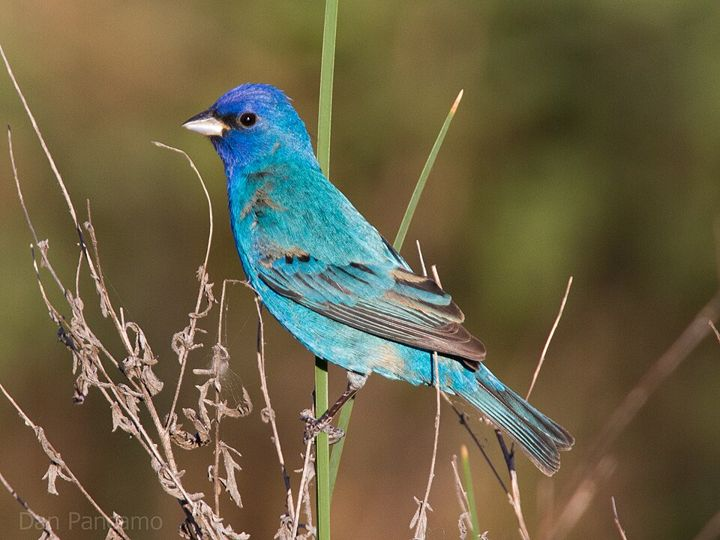
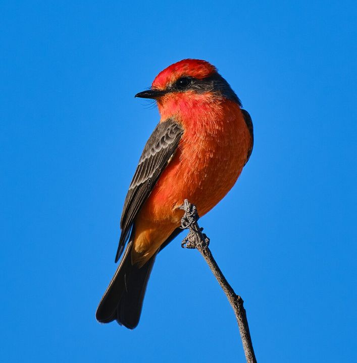
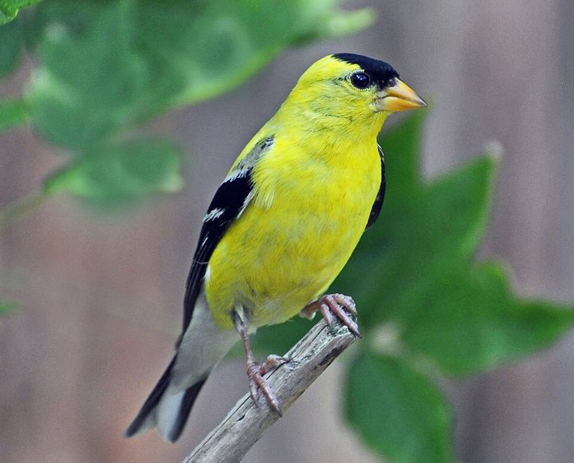
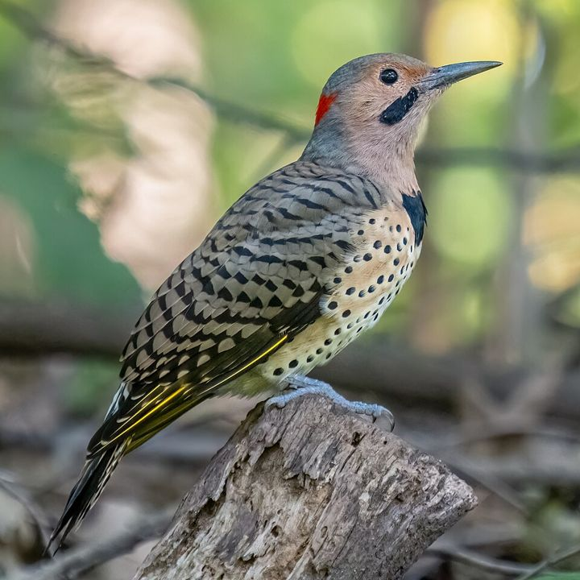
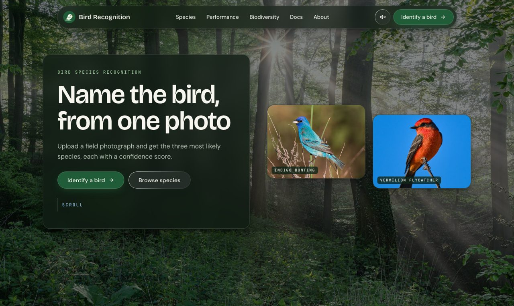
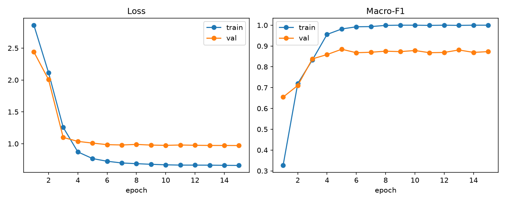

# Deep Learning-Based Bird Species Recognition

Upload a photo of a bird and get the three most likely species, each with a confidence score.

[**Open the live site**](https://bird-species-recognition.vercel.app) ·
[Documentation](https://bird-species-recognition.vercel.app/docs) ·
[Model performance](https://bird-species-recognition.vercel.app/performance)

Four of the species the model recognises: Indigo Bunting, Vermilion Flycatcher, American Goldfinch, Northern Flicker.

## Contents

- [Overview](#overview)
- [Screenshot](#screenshot)
- [Results](#results)
- [How it works](#how-it-works)
- [Project layout](#project-layout)
- [Getting started](#getting-started)
- [Retraining the model](#retraining-the-model)
- [Limitations](#limitations)
- [Roadmap](#roadmap)
- [Team](#team)
- [Credits and licences](#credits-and-licences)

## Overview

The project has two parts:

- **Training pipeline.** Python scripts that check a bird image dataset, split it without leakage,
  fine-tune a ResNet-50 network and measure it on held-out photos.
- **Website.** A Flask application that loads the trained model and identifies uploaded photos.

It is the Phase 1 baseline of an Environmental Science Project (BAIP508) in the Department of
Artificial Intelligence and Machine Learning.

| Page | What it does |
|---|---|
| Home | Introduces the project and links to every page |
| Identify | Upload a photo, get the top-3 species with confidence |
| Species | Photos of the 25 species the model knows |
| Performance | Test accuracy, training curves and confusion matrix |
| Biodiversity | Planned for Phase 2, not built yet |
| Docs | How the project works, in full |
| About | Team and photo credits |

## Screenshot

## Results

Trained on 25 species from CUB-200-2011, split 1,050 train / 225 validation / 225 test images.
Measured once on the held-out test split:

| Metric | Result | Meaning |
|---|---|---|
| Top-1 accuracy | 87.6% | The first answer is the right species |
| Top-5 accuracy | 98.7% | The right species is among the first five answers |
| Macro-F1 | 0.878 | Average of each species' own score, so every species counts equally |

Most errors are between the all-black species: Fish Crow, American Crow and Shiny Cowbird.

  

The evidence behind these numbers is in the repository:

- `runs/resnet50/` holds the run log, curves, confusion matrix and per-image test predictions.
- `data/manifest/` holds the split manifest, per-class counts and the rejected-file log.

## How it works

### Training (offline, PyTorch)

1. **`prepare_data.py`** scans a folder with one sub-folder per species. It rejects corrupt files
   and exact duplicates, groups near-duplicate images so they stay in one split, and writes a
   70:15:15 train/validation/test manifest.
2. **`train.py`** fine-tunes an ImageNet-pretrained ResNet-50 on 224 × 224 images, with
   augmentation on the training split only. It keeps the weights with the best validation
   macro-F1, then scores them once on the test split.
3. **`export_onnx.py`** converts the best weights to ONNX, so the website runs without PyTorch.

| Setting | Value |
|---|---|
| Network | ResNet-50, ImageNet weights, final layer replaced |
| Input | 224 × 224, ImageNet normalisation |
| Augmentation | Random crop, horizontal flip, colour jitter (training split only) |
| Schedule | 15 epochs; first 2 train only the new layer |
| Optimiser | AdamW, cosine decay, label smoothing 0.1 |

### Website (Flask + ONNX Runtime)

1. The browser posts the photo to `/identify`.
2. `app.py` resizes it to 256 px on the short side, centre-crops 224 × 224 and normalises it,
   the same steps used for validation during training.
3. The ONNX model returns one score per species; softmax turns the scores into confidences.
4. The page shows the three highest, each with a reference photo of that species.

Uploaded photos are processed in memory and are not saved. There is no database.

## Project layout

    app.py               Flask website and inference
    templates/, static/  Pages, styles, script and photos
    model/               ONNX model and class list used by the site
    prepare_data.py      Data QA and leakage-controlled split
    train.py             Training and evaluation
    export_onnx.py       PyTorch weights -> ONNX
    predict.py           Command-line prediction with the PyTorch weights
    fetch_inat.py        Downloads Indian species photos from iNaturalist
    common.py            Model and transforms shared by the training scripts
    runs/resnet50/       Results of the training run
    data/manifest/       Split manifest and data QA reports

## Getting started

    git clone https://github.com/Anu062004/Evs.git
    cd Evs
    pip install -r requirements.txt
    python app.py

Then open http://127.0.0.1:5000. The trained model is included, so no training is needed to run
the site.

## Retraining the model

    pip install -r requirements-train.txt
    python prepare_data.py --data-dir data/raw --max-classes 25
    python train.py --manifest data/manifest/manifest.csv --data-dir data/raw
    python export_onnx.py --weights runs/resnet50/best.pt

`data/raw` holds one folder per species. The dataset itself is not in this repository.
Run `train.py` with `--epochs 1 --limit-per-class 10` first as a quick smoke test.

## Limitations

- **Closed set.** A bird outside the 25 species, or a photo with no bird, is still given one of
  those names.
- **Confidence is not certainty.** A high percentage means the model prefers that species over
  the others it knows, not that the answer is verified.
- **One bird per photo.** The whole image gets a single label.
- **Small test set.** There are 9 test photos per species.
- **North American species.** CUB-200-2011 does not cover Indian birds.

## Roadmap

- Add Indian species from iNaturalist and retrain (in progress; `fetch_inat.py` is the downloader).
- Compare ResNet-50 with other networks.
- Detect several birds in one photo.
- Flag unknown species instead of forcing a known name.
- Grad-CAM explanations.
- Biodiversity indices for a survey site.

## Team

Sonali N Gowda, Anubhav, Reyyi Shreyas and Mayank Prakash, guided by Prof. Shobith Tembhre.

## Credits and licences

- **Training data:** CUB-200-2011 (Caltech-UCSD Birds), used for non-commercial research and
  education.
- **Photographs on the site and in this README:** Wikimedia Commons, under Creative Commons
  licences. Every photographer and licence is listed in
  [`static/img/credits.json`](static/img/credits.json) and on the site's About page. The four
  photos above are by Dan Pancamo (CC BY-SA 2.0), Henry (CC BY 2.0), Rodney Campbell (CC BY 2.0)
  and Rhododendrites (CC BY-SA 4.0).
- **Forest background:** Dietmar Rabich, CC BY-SA 4.0.
